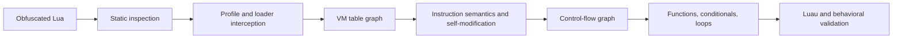

# NARSIL

**An experimental Luraph deobfuscator and Lua/Luau VM recovery toolkit. Recover the logic. Reforge the code. и темы luraph, luraph-deobfuscator, luraph-deobf, deobfuscation, deobfuscator, lua, luau, reverse-engineering, devirtualization**

A toolkit for analyzing virtualized Lua/Luau: static inspection, planning the
capture of unpacked VM data, and recovering Luau from a compatible dump.
Requires Python 3.10+ and has no third-party runtime dependencies.

This project grew out of hands-on script recovery. It includes reusable tools
and original educational examples. Game source code, game assets, and private
dumps are not included in the repository.

**Status: experimental.** The `column-vm-v1` adapter supports one observed VM
table layout and its instructions. A matching "Luraph" label or version number
does not guarantee compatibility. This is not a universal decompiler for all
13.8.1/14.x builds, and it does not recover original names or comments.

## Quick start

From the root of the downloaded repository:

```sh
python -m luraph_lab profiles
python -m luraph_lab demo --out work/demo
python -m unittest discover -s tests -v
```

`demo` runs the recovery pipeline on a small synthetic VM graph. It writes
Luau and diagnostic artifacts to the output directory. Use a new directory
when running it again: the CLI refuses to overwrite a nonempty directory.

Installation is optional. To add a standalone command to your Python environment:

```sh
python -m pip install .
luraph-lab --help
```

Building the package uses setuptools; running it directly with `python -m`
does not require setuptools to be installed.

## Usage

### Inspect strings and file structure

```sh
python -m luraph_lab inspect private/input.lua --out work/inspection
```

This command identifies literals, decodes supported escape sequences, and writes
`normalized.lua`, `strings.json`, large binary strings, and `manifest.json`.
It does not execute Lua code. Normalizing strings alone does not remove the
virtual machine.

### Prepare a loader capture

```sh
python -m luraph_lab capture-plan private/input.lua --profile private/capture-profile.json --out work/capture-plan
```

The profile is tied to the exact input file's SHA-256 and specifies reviewed
replacement points. The generator changes the loader's exit to return VM data
instead of invoking the main function. It creates a file for manual review and
execution in a suitable environment. It does not execute that file or connect
to Studio.

The step guard and entry-point interception **are not a sandbox**: the loader
can have side effects before reaching the interception point. Analyze it first,
then use a separate, controlled environment. The example profile must be adapted
before it can be used with another script.

### Recover code from a compatible dump

```sh
python -m luraph_lab recover private/capture.json --profile column-vm-v1 --out work/recovered
```

The input is a serialized graph of unpacked tables, not the original obfuscated
`.lua` file. The adapter resolves supported instruction rewrites, builds a
control-flow graph, recovers functions, conditionals, and loops, and emits Luau.
Unsupported instructions or structures must cause an explicit failure rather
than silently disappearing from the output.

The recovered code still needs behavioral validation. Compiling the source,
checking control-flow transitions, and testing selected inputs provide different
guarantees. None of these steps alone proves full program equivalence.

## How it works



The core idea is to recover the values and sequence of operations executed by
the VM interpreter. This requires identifying the instruction table, how operands
and constants are read, where branches lead, and how functions capture variables.
The VM representation can then be translated into ordinary language constructs.

Details and examples:

- [The method: from loader to readable Luau](docs/METHOD.md).
- [Dump format and adapter development](docs/ADAPTERS.md).
- [What to validate and what tests do not prove](docs/VALIDATION.md).
- [Preparing and publishing the repository on GitHub](docs/PUBLISHING.md).
- [Contributing](CONTRIBUTING.md).

## Limitations

- Arbitrary VMs are not detected automatically.
- A new data format or different opcode numbering requires a new adapter.
- Original local names, comments, and formatting are not recovered.
- The CLI does not execute Lua, download Roblox assets, or remove game access
  checks. Game-specific fixes are outside the scope of the general method.
- Luau string interpolation and other unsupported syntax must produce an
  explicit diagnostic error.
- Public examples are synthetic. An adapter working on one private sample does
  not establish support for every program produced by the same obfuscator.

## Related work

[PhoenixZeng/LuraphDeobfuscator](https://github.com/PhoenixZeng/LuraphDeobfuscator)
describes a related approach that recovers `.luac` bytecode and then decompiles
it. This project uses its own Python/Luau pipeline; no code was copied from
that repository.

## License

[MIT](LICENSE). Use these tools on code you are authorized to analyze.
