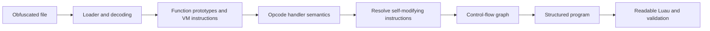
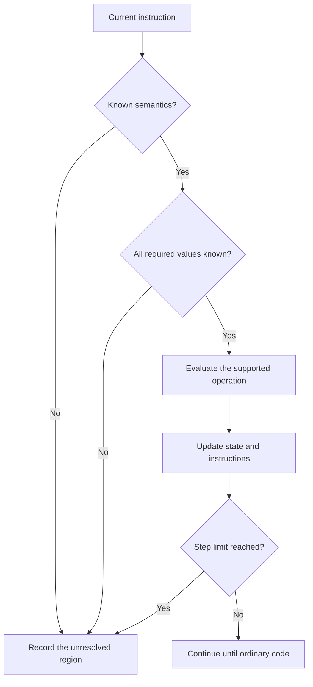

# Recovering a Program from a Virtual Machine

NARSIL helps analyze Lua/Luau programs that an obfuscator has transformed into data and an interpreter. The goal is to recover an understandable program whose behavior can be tested. Recovering the original file byte for byte is usually impossible: local variable names, comments, formatting, and some of the original structure have already been lost.

This document describes the full investigation process. The project's commands automate only the stages identified as such. A guide to recovering readable Luau does not mean that `recover` automatically produces a ready-to-use game script. The actual inputs, outputs, and limitations are documented in [ADAPTERS.md](ADAPTERS.md).

## Why Decoding Strings Is Not Enough

For loaders whose byte transforms can be reproduced without execution, see the
[offline workflow](OFFLINE_VM_RECOVERY.md). It covers custom buffer VMs, nested
native-bytecode layers, and the new unpacking tools.

Simple string obfuscation may hide program text in numbers, escape sequences, or a compressed block. Unpacking it sometimes produces ordinary Lua code. This is **literal unpacking**.

With virtualization, the data contains a different program: a sequence of instructions for a custom virtual machine. An interpreter for those instructions sits alongside it. A decoded string might be nothing more than a field name or a single constant. Recovering behavior requires understanding the instructions, branches, and functions. This is **devirtualization**.



Save the results of each stage separately. If a readable function behaves incorrectly, being able to trace it back to the original instruction is much more useful than running another formatter.

## 1. Separate the Loader from the Application

First, find the boundary between preparing the virtual machine and starting the user's program. A typical wrapper does several distinct things:

1. Obtains environment functions, such as string and table operations.
2. Unpacks literals and a binary stream.
3. Builds function prototypes, constant tables, and instructions.
4. Creates a closure for the interpreted function.
5. Calls that closure and begins executing the application.

The boundary between steps 4 and 5 is especially important. An investigation often needs the data and the closure factory without starting the game, connecting handlers, or contacting external services.

Some wrappers have two stages: the first interpreter call still decodes the program, while the second executes the application. The rule "remove the last call" is therefore only a hypothesis to check against the data flow. Two calls that look alike do not necessarily serve the same purpose.

In some investigations, it is useful to replace the final application return with a table containing the prototype and function factory. Such an adapter is specific to the wrapper being examined. This project does not treat an arbitrary regular-expression replacement as proof that the application can no longer run.

`capture-plan` helps prepare this stage. A plan is not yet a capture. If obtaining the prototypes requires executing code, that happens separately in an environment chosen by the investigator. The Python CLI does not provide a sandbox for running Lua.

### What to Check Before Capture

- Which sections must execute before the prototype is returned.
- Whether the decoder calls environment functions or table metamethods.
- Where the step limit is enforced and how exceeding it is reported.
- Which side effects the decoder can perform in the chosen environment.
- Whether a copy of the original file was saved before modifying the wrapper.

A step limit helps stop a decoder stuck in a loop. It does not isolate the filesystem, network, or environment APIs, and it is not a substitute for that isolation.

## 2. Capture Prototypes Without Losing Values

A prototype describes a function before a particular closure is created. In the layouts being investigated, it may contain instructions, a parameter count, a vararg flag, a stack size, child prototypes, and upvalue descriptors. A field's meaning comes from the code that reads it, not its position in the table.

Do not reuse a field map from another file just because both headers name the same obfuscator version. Even similar wrappers may differ in column order, operand encoding, and handler behavior.

For each field, record the evidence behind its interpretation: "used as the parameter count in the argument-copying loop," "this table is indexed by instruction number," or "these are captured-variable descriptors." That record turns a guess into an adapter contract that can be checked.

The export must preserve distinctions that JSON can easily lose:

- `nil` as a value, a missing key, and the end of an argument list;
- the string key `"1"` and the numeric key `1`;
- `false`, `0`, and the empty string;
- instruction order and the direction of references between prototypes;
- the number of results from a call, even when some are `nil`;
- special numeric values, if they actually occur.

In Lua/Luau, `0` and the empty string are truthy. Porting an evaluator to Python without an explicit Lua truthiness rule silently changes branches.

Complex environment objects cannot simply be replaced with their text representations and the export declared complete. References and explicit type tags are usually enough for instruction analysis. Testing the application may require separate mocks for those objects.

## 3. Recover Opcode Semantics

An opcode number identifies a handler in a particular VM. The number alone says nothing about the operation. For every number in use, read the corresponding dispatcher branch and describe its effect:

- which operands it reads;
- which registers, tables, or upvalues it changes;
- how it computes the next instruction address;
- whether the operation can call a function or metamethod;
- how it handles variable numbers of arguments and results.

For example, this is a **synthetic** instruction for an imaginary VM:

```text
ADD_CONST destination=2 source=1 constant=5
```

Its semantics might be `registers[2] = registers[1] + 5`. A real handler assigned the same opcode number, however, might first decrypt an operand, modify another instruction, and only then perform the addition. A profile must describe observed behavior, not an expected label.

A fused opcode may perform several operations in one step. Breaking it into understandable operations is useful as long as evaluation order, side effects, and branch conditions are preserved. Table accesses deserve particular care: `object.field` may invoke `__index`, and an assignment may invoke `__newindex`.

An unknown opcode must remain explicitly unknown. Replacing it with a no-op makes the output look cleaner but makes the recovery impossible to trust.

## 4. Resolve Self-Modifying Instructions

In some VMs, code changes its own columns during decoding or execution: it replaces handler numbers, decrypts operands, or redirects instructions. If a disassembler reads only the initial values, it sees the loader's intermediate language rather than the final program.

One useful approach is to evaluate small regions that modify only known VM data. This requires a restricted interpreter for supported expressions. It must not pass arbitrary expressions to Python `eval` or launch the original Lua through a system shell.

The evaluator maintains state: known numbers and strings, references to supported tables, the instruction address, and writes to VM data. If a value depends on a game object, an unknown call, a metamethod, or an unsupported operation, evaluation stops with an explanation. An incomplete result is more useful than an invented one.



Not every file needs this stage, and not every self-modifying region can be evaluated statically. The profile must state which forms it can resolve.

## 5. Build the Control-Flow Graph

After normalizing the instructions, determine their possible successors. A control-flow graph, or CFG, consists of basic blocks and edges between them. A basic block is a sequence of instructions with no internal branching; the edges indicate which block may execute next.

Two kinds of evidence must be distinguished:

- **Static reachability:** both sides of a conditional branch are explored unless one is proven impossible.
- **Dynamic trace:** only branches executed for the selected inputs are visible.

A function does not become dead code because one test never called it. A branch that handles a missing object cannot be discarded merely because the object was always present during normal gameplay.

The graph helps identify `if` statements, early `return` statements, repeated regions, and loops. A block number or a backward jump, however, does not identify the original language construct. Similar graphs may represent `while`, `repeat`, or a loop containing `break`.

## 6. Turn Pseudocode into Readable Luau

A register is a temporary storage slot in the interpreter. It does not necessarily correspond to one original variable. A single register may hold a number, then a function, then an object; one logical variable may move between registers.

That makes a file-wide replacement of `R12` with `player` risky. First analyze where each value is defined and used, then separate its lifetimes, and only then assign names. A useful name reflects the value's role: a handler argument, a located object, current health, or a returned result. When the role is unknown, a neutral name is more honest than a guess.

A structured abstract syntax tree, or AST, represents a program in terms of functions, conditions, loops, and expressions. It is useful for final code generation, but constructing it correctly is harder than printing instructions. In the current workflow, this stage may require manual reconstruction. A readable register listing does not by itself mean that the AST has been recovered.

The following educational example was written specifically for this guide. It shows how a dispatcher can be replaced with a simple function. It is not a Luraph sample or the CLI's input format.

```lua
-- Before: a small VM with three known operations.
local function toyVM(input)
    local code = {
        {"ARG", 1},
        {"ADD", 2, 1, 5},
        {"RETURN", 2},
    }
    local registers = {}
    local pc = 1
    while true do
        local instruction = code[pc]
        if instruction[1] == "ARG" then
            registers[instruction[2]] = input
        elseif instruction[1] == "ADD" then
            registers[instruction[2]] = registers[instruction[3]] + instruction[4]
        elseif instruction[1] == "RETURN" then
            return registers[instruction[2]]
        else
            error("unknown toy opcode")
        end
        pc = pc + 1
    end
end
```

```lua
-- After: an equivalent function for numeric input.
local function addFive(input)
    return input + 5
end
```

The line count has decreased, but that does not prove equivalence. The evidence comes from the semantics of the three handlers and verification of the input contract. For a real function, the following cases also need attention.

### Closures: References and Values

A closure may capture a variable through a shared cell rather than copy its value when the closure is created. For example:

```lua
local function makeCounter()
    local count = 0
    local function increment()
        count = count + 1
        return count
    end
    local function read()
        return count
    end
    return increment, read
end
```

`increment` and `read` must see the same variable. If a decompiler creates two independent copies of zero, a simple test of the first call may pass while the second handler already behaves incorrectly. Upvalue handling must distinguish a reference to a local cell in the parent invocation, a reference to a parent upvalue, and a value captured under a VM-specific rule. It must also account for when a cell is closed as its scope ends.

### Multiple Results and `nil`

A call may return zero, one, or several values. A call expression in the last position of a Lua expression list can expand to multiple results. This affects assignments, arguments to other calls, and `return` statements.

```lua
local function values()
    return "first", nil, "third"
end

local packed = table.pack(values()) -- Luau: packed.n == 3
```

Do not use `#packed` as a reliable substitute for the result count: the list has a hole. Fixtures must preserve an explicit `n` and compare values at indices 1 through `n`. Parenthesizing a call or assigning it to a single intermediate variable can also reduce the number of results. Those constructs must not be "simplified" without analysis.

### Evaluation Order and Method Calls

`object:method(value)` passes the object as `self`. Reconstructing it as `object.method(value)` changes the API. The reverse transformation is also incorrect if the original call already passed `self` explicitly.

Do not combine two property reads into one just to make the code cleaner if a read may invoke a metamethod or if a call with side effects occurs between the reads. Similarly, adding an early `return` after cleanup may be a sensible bug fix, but that change must be recorded separately from devirtualization.

### Loops and State Between Calls

A numeric `for` evaluates its initial value, limit, and step before iteration begins. Replacing it with an arbitrary `while` loop that rereads a mutable limit on every iteration can change behavior. A generic `for` must preserve its iterator, state, and control value. A `repeat` loop executes its body before the first condition check, and locals declared in the body may be used in that condition.

Recovering a function body is not enough; module state also matters: shared tables, event subscriptions, created closures, and their registration order. Two identical calls to the same function are not necessarily independent.

## 7. Validate Behavior at Several Levels

It is useful to distinguish three recovery outcomes:

1. **The data was parsed.** The prototype and instruction structures match the adapter.
2. **The function's behavior matched.** The original VM function and the readable function produced matching behavior for the same controlled inputs.
3. **The application works in its environment.** Real objects, events, animations, assets, and client-server interactions have been checked.

These levels do not replace one another. A successful JSON export does not test calls. A differential test with mocks does not establish animation permissions or correct model assembly. Successfully running one application scenario does not cover rare handler branches.

Practical guidance and evidence formats are provided in [VALIDATION.md](VALIDATION.md).

## Describe Results Accurately

Use precise statements in reports: "prototypes parsed," "all reachable operations resolved for this adapter," "N functions recovered," "N input scenarios tested," or "these branches remain untested." Saying "Luraph is supported" is too broad when a tool has been tested on one observed VM layout.

Similar code and a matching version number justify trying an adapter; they do not establish compatibility. Check the prototype layout, handlers, branches, constant encoding, and calling rules.

## Related Work

The README for [PhoenixZeng/LuraphDeobfuscator](https://github.com/PhoenixZeng/LuraphDeobfuscator) states that it was tested on Luraph v11.5–v11.8.1 and describes generating `.luac` followed by decompilation with `unluac`. That is a separate tool with its own stated capabilities; those claims do not carry over to NARSIL. No code from that repository is included in this project.

This project focuses on an observed VM format, reproducible intermediate results, and validation of recovered behavior. Going through standard Lua bytecode is useful only when the semantics of the VM under investigation actually allow that representation.
