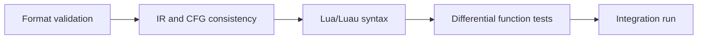

# Validating Reconstructed Code

`recover` intentionally returns `status: "intermediate"`. A successful command means the input met the adapter's constraints and the pipeline produced a consistent intermediate representation. It does not yet prove that the application has been fully recovered or works in its intended environment.



Each stage answers a different question. An animation asset error does not prove a decompilation error, and a working interface does not prove that every handler is correct.

## Reproducible Toolkit Checks

Version 0.3.0 adds offline transform and bytecode-inventory checks.
Run the following in addition to the existing commands:

~~~sh
python -m narsil demo-offline --out work/validation-offline
~~~

This exercises the nested envelope and existing graph recovery together.
The native-bytecode reader checks structure; it does not execute code words.

From the repository root:

```sh
python -m unittest discover -s tests -v
python -m narsil demo --out work/validation-demo
python -m narsil capture-plan examples/toy_loader.lua --profile examples/capture_profile.example.json --out work/validation-capture
```

Choose new output directories when running these commands again. The commands do not execute the input Lua.

The Python tests cover static analysis, capture profile constraints, graph loading, and individual reconstruction cases. The educational `demo` exercises the full public command on synthetic input. The example sources were written for this repository and contain no private programs.

The separate [examples/native_checks.luau](../examples/native_checks.luau) contains authored checks of Luau semantics. This module returns a function containing assertions. In Studio, you can place it in a separate ModuleScript and manually call the returned function:

```lua
local runChecks = require(pathToChecksModule)
runChecks()
```

Here, `pathToChecksModule` refers to the ModuleScript you created. The Python CLI neither installs nor runs it. In another Luau host, use that host's module loading mechanism.

The separate [examples/serializer_checks.luau](../examples/serializer_checks.luau) returns a function that accepts the function from `narsil/resources/graph_serializer.luau`. This lets you repeat the native export checks without running a third-party loader.

```lua
local runSerializerChecks = require(pathToSerializerChecksModule)
local serializeGraph = require(pathToSerializerModule)
runSerializerChecks(serializeGraph)
```

Both paths refer to ModuleScripts containing the corresponding educational file and serializer.

During preparation of the current suite, 41 Python tests, 7 native contracts from `native_checks.luau`, and 8 serializer checks passed locally. The native contracts cover arithmetic, mutable captures with cell closing, fixed and variable result counts, and `nil` in varargs. The serializer checks cover `false`, binary strings, table cycles, special numbers, lazy reads, and rejection of unsupported types. The educational loader interception was also checked in Luau. These results apply to the educational examples and do not expand the adapter's compatibility scope.

A CI configuration file means the checks are configured. A successful GitHub Actions run can only be claimed after the workflow has actually run in the published repository.

## What Abstract Traces Check

The pipeline compares transitions in the original IR and the structured representation across 30 bounded abstract scenarios per function. This helps detect missing branches, incorrect loop continuations, or extra `return` statements introduced during structuring.

These traces do not run the original Lua interpreter, execute the application, or check physics, property values, or network events. Abstract traces can match even when an arithmetic handler's semantics are wrong. They therefore supplement opcode verification and native tests rather than replace them.

Reports should distinguish between:

- the number of abstract structuring traces;
- the number of native input scenarios;
- the number of functions and branches checked;
- the number of actual application scenarios.

Combining these into a single unexplained "test" count provides little useful information.

## Differential Function Testing

The idea is simple: call the original VM function and the reconstructed function with identical inputs, then compare their observable results. The original serves as the behavioral reference, including its quirks. That does not make it a reference for good design or freedom from bugs.

A practical sequence:

1. Isolate one function and its dependencies: arguments, upvalues, mutable tables, and global functions it uses.
2. Create two independent, identical environments. One call must not contaminate the other's state.
3. Replace external effects with controlled mocks if the chosen environment supports this kind of execution.
4. Supply identical values, random number sequences, and deferred call schedules.
5. Compare return values, state changes, errors, and the effect log.
6. Investigate every difference before extending the checks to related functions.

This is an analyst's workflow, not a built-in universal execution engine. It requires a separately prepared way to obtain the original function and control its environment. Arbitrary loader execution must not be considered safe merely because later calls to a few APIs will be mocked.

### What to Compare

**Results.** Preserve the explicit number of return values. In Luau, `table.pack` is useful: compare `n`, then elements `1..n`. Zero results, one `nil`, and three results with `nil` in the middle are distinct cases.

**State changes.** Check more than the final number: include shared tables, deleted keys, created closures, and behavior on repeated calls. For captures, check shared cell identity rather than equality of the cell's current value.

**Side effects.** A mock can record calls such as "get an object," "change a property," "create a tween," or "send an event." Compare their order, arguments, and counts. A single final object will not reveal that an event was sent twice.

**Errors.** Compare whether both sides complete successfully. If both fail, check the stage and meaning of the error; variable names and line numbers in messages may legitimately differ. Do not treat every exception as an expected match.

**Numbers.** Integer counters, indices, and identifiers usually require exact equality. For floating-point calculations, use a justified tolerance and record the maximum deviation. An overly generous tolerance can hide an incorrect formula. `NaN` requires a separate comparison because it is not equal to itself.

**Unknown APIs.** A mock should explicitly report unexpected accesses. A universal object that returns another such object for any property can easily hide naming and branching errors.

## Inputs That Find Real Bugs

Choose inputs for each function based on its branches and contract, not just random numbers. Useful cases include:

- an object that is present or absent, an empty collection, and a collection with several elements;
- `nil`, `false`, `0`, and an empty string wherever those values are valid;
- values below, exactly at, and above a comparison boundary;
- every state selector or action type;
- zero, one, and multiple arguments or results;
- repeated calls after shared state changes;
- two closures over a shared variable, including calls after it has been closed;
- loops with zero, one, and multiple iterations;
- early exits before and after a side effect;
- a call in which a dependency fails, if the original code handles that failure.

Random inputs are useful after these cases. For reproducibility, save the seed and the specific input that caused a difference.

## Syntax Checks and Application Execution

First, check the generated file in the target dialect. A successful Python generator run is not a Luau compilation. The current output also returns a function: running the application requires separately recovering its contract and invocation method. Do not automatically append `()` to every result.

Integration testing comes next. In Roblox or another host, this may include:

- the required services, modules, folders, and objects;
- the correct initialization sequence;
- object types and whether properties being assigned are writable;
- asset loading and permissions;
- character, joint, and animation compatibility;
- the distribution of client and server logic;
- correct creation, connection, and cleanup of handlers;
- completing an entire user action and checking state changes on both sides.

These checks are application-specific. The toolkit does not include a universal game installer or an automated Play test.

For example, a pose formula may match the original function while the target object in the current environment exposes a read-only property. In that case, formula recovery succeeded, but environment compatibility requires a separate fix. That fix should have its own test and description.

## Separate Recovery from Fixes

If the original accesses an object after cleaning it up and then fails, adding an early `return` may be an appropriate application fix. It is still a behavior change. The report should record:

1. Which input reproduces the original error.
2. What matched before the error occurred.
3. Which change was intentional.
4. How the expected behavior after the change was verified.

Do not silently change probabilities, access rules, limits, or branches just because they look unusual. Reconstruction is about preserving semantics; changing requirements is separate work.

## A Minimal Validation Log

For your own research, it is useful to keep a record like this. The values below are a **template**, not a report of a completed test:

```json
{
  "adapter": "column-vm-v1",
  "source_revision": "record-your-revision",
  "runtime": "record-host-and-version",
  "fixture": "authored-fixture-name",
  "input_cases": 0,
  "matching_cases": 0,
  "unexpected_differences": [],
  "intentional_changes": [],
  "unverified_paths": ["list remaining paths"],
  "integration_status": "not run"
}
```

For a private project, add input hashes, tool versions, complete execution parameters, and a minimal input for each discrepancy. Publishing such a log should not require disclosing someone else's source code or a private dump. For this repository, prefer a standalone synthetic regression case that demonstrates the same toolkit defect.
